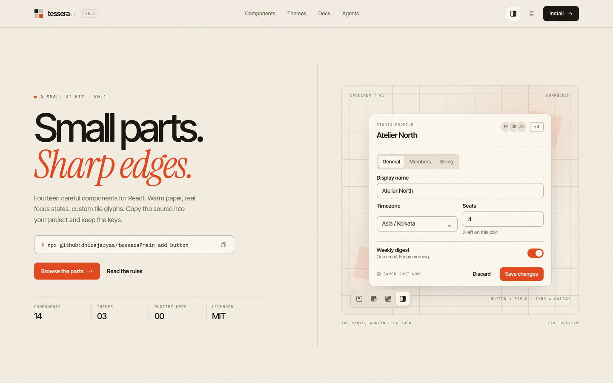

# Tessera

A small, original copy-paste UI kit for React and Tailwind CSS v4.

Tessera is 14 components, three themes and zero runtime dependencies. You copy the source into your project with one CLI command and keep it. There is no UI package in `node_modules`, no Radix layer, and no version lock.

Live documentation: [https://dhirajaryaa.github.io/tessera](https://dhirajaryaa.github.io/tessera)



## The idea

1. **Own the source.** A component lands in your repository as a file you can read, rename and break. You commit it with the rest of your code.
2. **Tokens, not classes.** Every surface, line and accent is a `--ts-*` CSS variable. Change a block and the whole set follows.
3. **Boring on purpose.** Native HTML, plain React state and Tailwind v4. No hidden runtime, no provider unless a part needs one.

The visual language is warm and editorial: bone paper, near-black ink, one vermilion accent and a deep green alternative. The theme switch uses four custom tile glyphs, not a sun and a moon.

## Requirements

- Node 18 or newer for the CLI
- React 18 or 19
- Tailwind CSS v4
- TypeScript
- A path alias such as `@/*` in `tsconfig.json`

## Install

```bash
# 1. Set up the token sheet, utils and config
npx github:dhirajaryaa/tessera#main init

# 2. Add the parts you need
npx github:dhirajaryaa/tessera#main add button dialog

# 3. List everything in the registry
npx github:dhirajaryaa/tessera#main list
```

Init writes `tessera.json`, copies `tessera.css` next to your global stylesheet, writes `utils.ts` with `cn()`, and adds the import after Tailwind:

```css
@import "tailwindcss";
@import "./tessera.css";
```

The root element needs a theme:

```html
<html lang="en" data-theme="paper">
```

The CLI installs `clsx` and `tailwind-merge` only if you do not already have them.

## Use

Import the file from your local components directory:

```tsx
import { Button } from "@/components/tessera/button";
import { Dialog, DialogClose } from "@/components/tessera/dialog";
import { Field, Input } from "@/components/tessera/input";

export function ArchiveProject() {
  return (
    <Dialog
      title="Archive this project?"
      description="It leaves the active list. You can restore it later."
      trigger={<Button variant="outline">Archive</Button>}
      footer={
        <>
          <DialogClose className="rounded-ts px-3 py-2 text-[13px] font-semibold text-ts-ink hover:bg-ts-surface-2">
            Cancel
          </DialogClose>
          <DialogClose className="rounded-ts bg-ts-accent px-3 py-2 text-[13px] font-semibold text-ts-accent-ink">
            Archive
          </DialogClose>
        </>
      }
    >
      <Field label="Reason" htmlFor="archive-reason" hint="Optional. Visible to your team.">
        <Input id="archive-reason" placeholder="No longer active" />
      </Field>
    </Dialog>
  );
}
```

## Components

| Component | What it is |
| :--- | :--- |
| `button` | Solid, soft, outline, ghost and link actions with a loading state. |
| `badge` | Compact status with six tones and an optional dot. |
| `input` | Text control with a visible focus ring, plus Field for labels and errors. |
| `textarea` | Multi-line text that keeps a real resize handle. |
| `select` | Native select under a custom chevron. |
| `checkbox` | Native checkbox with a drawn square and a label group. |
| `switch` | Immediate on or off, with a native checkbox underneath. |
| `card` | A surface with header, content and footer. |
| `tabs` | Peer views with arrow-key navigation. |
| `dialog` | Focus trap, Escape, focus restore and a labelled panel. |
| `toast` | A polite live region with auto-dismiss. |
| `accordion` | Single or multiple disclosure with real aria states. |
| `avatar` | Image or initials, with a group wrapper. |
| `theme-switcher` | Four tile glyphs for Paper, Ink, Moss and Auto. |

## Themes

The themes are CSS variable blocks on `:root` and `[data-theme="..."]`. Paper is the warm light default; Ink turns the lights down; Moss is a deep green with an amber edge. Auto follows the operating system.

The core tokens:

| Token | Paper | Ink | Moss |
| :--- | :--- | :--- | :--- |
| `--ts-bg` | `#f2ece1` | `#121110` | `#0d1712` |
| `--ts-surface` | `#fbf7ee` | `#1a1815` | `#14221a` |
| `--ts-ink` | `#1a1712` | `#f2ece2` | `#e8f0e3` |
| `--ts-muted` | `#6e6558` | `#a79b8b` | `#9eb09f` |
| `--ts-accent` | `#e24a21` | `#ff6b3d` | `#e9b44c` |
| `--ts-radius` | `8px` | `8px` | `8px` |

`--ts-font-sans`, `--ts-font-mono`, `--ts-font-display`, `--ts-line`, `--ts-line-strong`, `--ts-surface-2`, `--ts-accent-hover`, `--ts-accent-ink`, `--ts-success`, `--ts-warning`, `--ts-danger` and `--ts-shadow` complete the sheet.

Read the guides in [docs/theming.md](docs/theming.md) and on the [site](https://dhirajaryaa.github.io/tessera/docs/theming).

## Documentation

- [Installation](docs/installation.md)
- [Themes](docs/theming.md)
- [Principles](docs/principles.md)
- [Components](docs/components.md)
- [For agents](docs/agents.md)
- [Contributing](CONTRIBUTING.md)
- [llms.txt](llms.txt)
- [Agent skill](skills/tessera/SKILL.md)

## Repository

```
.
├── bin/tessera.mjs          # zero-dependency CLI
├── registry.json            # component manifest
├── registry/tessera/        # canonical source and token sheet
├── site/                    # Next.js docs site, static export
├── docs/                    # Markdown guides
├── skills/tessera/SKILL.md  # portable agent skill
├── AGENTS.md                # agent contract
├── CLAUDE.md                # Claude Code notes
└── llms.txt                 # flat model index
```

The docs site is a separate Next.js app. The registry is synced into it at build time:

```bash
npm --prefix site install
npm --prefix site run sync
npm --prefix site run dev
```

## Branches and contributions

`main` is published. `dev` is the integration branch. Pull requests target `dev`.

Read [CONTRIBUTING.md](CONTRIBUTING.md) for the branch workflow, the registry contract, the files to update for a new component, and the review checklist. The short version: use native HTML, use the tokens, do not add a runtime dependency, and check all three themes.

## Contributors

- **Dhiraj Arya** ([@dhirajaryaa](https://github.com/dhirajaryaa)) — Creator and maintainer
- **Claude AI** (Anthropic) — Automated collaboration, component generation and documentation

## License

MIT. Use it in personal and commercial work.

Icons by [Pikaicons](https://pikaicons.com). Type set in Instrument Serif, Inter Tight and IBM Plex Mono.
